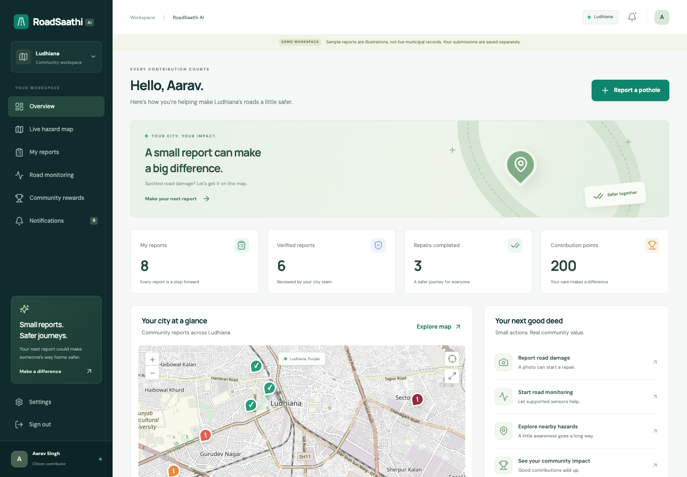

# RoadSaathi AI

**Smarter Roads. Safer Journeys.** A working civic road-reporting application rebuilt with Spring Boot and the MERN technologies, with AI intentionally disconnected until you are ready to configure it.

The app includes citizen reporting, photo uploads, a searchable live map, a municipal repair workflow, admin access management, rewards, notifications, analytics, offline submissions, and foreground sensor monitoring. All dashboard counts come from the database. Development data and illustrative photographs are visibly labeled.

**[Download the Android APK](https://github.com/rajratanrr/OPEN/raw/refs/heads/main/downloads/RoadSaathi.apk)** · [Phone installation guide](downloads/README.md) · [Download all source files](https://github.com/rajratanrr/OPEN/archive/refs/heads/main.zip)

The APK is a tested debug build for the existing Mac Wi-Fi server. Downloading it from GitHub works from any network; signing in and syncing require the configured Mac server on the same Wi-Fi. A public app server has not been deployed.



Map data © [OpenStreetMap contributors](https://www.openstreetmap.org/copyright).

## Open the current local installation

Open **[http://127.0.0.1:5173](http://127.0.0.1:5173)** on this Mac. The dashboard has also been opened in Codex's preview panel. If an old development tab is blank, reload it.

For this workspace, double-click **Start RoadSaathi.command** to restart the local services and open the app. The launcher uses the Java, PostgreSQL/PostGIS and MongoDB tools prepared in the workspace's `work/` directory. Those tools and database contents are not part of the portable source ZIP. For a different machine, use Docker below.

Development accounts, all using **`RoadDemo!2026`**:

| Role | Email |
| --- | --- |
| Citizen | `citizen@roadsaathi.demo` |
| Second citizen | `simran@roadsaathi.demo` |
| Municipal officer | `officer@roadsaathi.demo` |
| Administrator | `admin@roadsaathi.demo` |

The login screen's Citizen / Officer / Admin buttons fill these development credentials. They do not sign in automatically. You can also register a new citizen account, which starts with zero contributions.

## Android APK for your phone

Double-click **Start Phone Test.command** to open the download page. Scan its QR code with your Android phone on the same Wi-Fi, then tap **Download Android app**. No sign-in is needed to download. Open the downloaded `RoadSaathi.apk`, install it and use the citizen demo credentials above. Keep the Mac awake. The dashboard also has a **Get Android app** link. If the Mac's network address changes, double-click **Rebuild Phone App.command** and reinstall the new APK; the QR code updates automatically.

**Automatic:** start foreground Road monitoring with a secured phone and precise GPS permission. Strong impacts with usable speed and location become private **unverified possible bumps**, not confirmed public potholes. The app keeps the screen awake during monitoring and stops when backgrounded. Physical road calibration is still needed.

**Manual:** use Report a pothole, choose GPS/a pin/coordinates, add a photo and submit for review. Photo drafts work offline and synchronize when the server is reachable. AI image recognition remains disconnected. This Wi-Fi test version needs the Mac server; public HTTPS hosting is the next step for access from any network. See [Android instructions](docs/ANDROID.md).

## Run on another machine with Docker

Requires Docker Engine or Docker Desktop with Compose and Python 3 for generating secrets.

```sh
git clone https://github.com/rajratanrr/OPEN.git
cd OPEN
python3 scripts/setup.py
docker compose up --build -d
docker compose ps
```

Open **[http://localhost:8088](http://localhost:8088)**. Initial builds download Java and Node dependencies. PostgreSQL migrations and the development seed run automatically. The generated `.env` has random local database and signing secrets and is ignored by Git.

Mailpit's local email inbox is at **[http://localhost:8025](http://localhost:8025)**. In Docker development, password-reset emails are delivered there; nothing is sent to a real mailbox. Email is disabled in the existing native preview, which displays an honest configuration message when a reset is requested.

```sh
docker compose logs -f backend gateway
docker compose stop
docker compose start
```

Database volumes persist across restarts. Do not remove volumes unless you intend to erase this installation's records. Docker was unavailable on the build machine: the source was built and exercised against native databases; the Compose stack still needs its first Docker run.

## Architecture

| Component | Responsibility |
| --- | --- |
| React 19 + TypeScript + Vite + Tailwind | Responsive UI, forms, Leaflet maps, Recharts, IndexedDB outbox and service worker |
| Spring Boot 3.5 + Java 21 | Authentication, permissions, reporting, repair lifecycle, analytics, rewards and optional AI |
| PostgreSQL + PostGIS | Authoritative civic records, spatial queries, transactions, audits and unverified sensor events |
| Node.js + Express | Same-origin API gateway and authenticated raw telemetry ingestion |
| MongoDB | Private motion samples with a seven-day TTL |
| Capacitor + Android Java | Packaged app, actual accelerometer bridge and permission-based foreground GPS |
| Local disk or S3-compatible storage | Validated, resized, metadata-stripped JPEG evidence |

Spring Boot owns core business data. MongoDB is used for raw telemetry rather than duplicating civic records across databases. This keeps both Spring Boot and MERN useful without conflicting sources of truth.

See [architecture and ER diagrams](docs/ARCHITECTURE.md), [API reference](docs/API.md), [security and operations](docs/OPERATIONS.md), and [Android setup and device testing](docs/ANDROID.md).

## Development without Docker

Requires Node.js 22.12+ (tested on Node 24), Java 21+, PostgreSQL with PostGIS, and MongoDB 8. Use a database user able to create the `postgis` extension for the initial migration, or have an administrator create the extension first.

1. Run `npm ci` at the repository root.
2. Configure an ignored `.env.local` using the values shown below, with your own database password and a random signing secret of at least 48 characters.
3. Build the backend: `cd backend && ./mvnw verify && cd ..`.
4. Start the backend: `python3 scripts/run-backend.py`.
5. In another terminal, load the same environment and run `npm run gateway`.
6. Run `npm run dev` in a third terminal. Open `http://127.0.0.1:5173`.

```dotenv
DATABASE_URL=jdbc:postgresql://127.0.0.1:55432/roadsaathi
DATABASE_USERNAME=roadsaathi
DATABASE_PASSWORD=your-local-database-password
JWT_SECRET=your-random-signing-secret-with-at-least-48-characters
MONGODB_URI=mongodb://127.0.0.1:57017/roadsaathi
BACKEND_URL=http://127.0.0.1:8080
SPRING_PROFILES_ACTIVE=dev
DEMO_SEED=true
COOKIE_SECURE=false
MAIL_ENABLED=false
STORAGE_PATH=.data/evidence
```

For a production-mode local UI with offline reload support, use `npm run build` followed by `npm run preview -w frontend` instead of the Vite development server. Keep the backend and gateway running. Do not run both frontend servers on port 5173.

## Verification

```sh
npm test                         # Vitest/RTL and Node validation tests
cd backend && ./mvnw verify      # Java build, JUnit and Mockito
cd ..
node scripts/smoke.mjs           # Real HTTP checks against the running dev stack
npm run e2e                     # Playwright against the production preview
npm audit
```

Playwright uses an installed Chrome by default. Set `PLAYWRIGHT_CHANNEL=chromium` after `npx playwright install chromium` if needed. `TEST_WEB_URL` and `TEST_API_URL` select alternate web/API addresses. Run smoke and browser tests only against a development database: they create explicitly named synthetic QA accounts and reports. The AI smoke check expects AI to be disabled.

Actual results and remaining checks are recorded in [TESTING.md](docs/TESTING.md).

## AI later

No API key is bundled, saved, or required for manual reporting. The optional server-side OpenAI image adapter is implemented with consent, structured output, timeouts, image ownership checks, and manual fallback. It never invents an assessment when unavailable.

When you choose to connect it, configure `OPENAI_API_KEY` **only on the backend**, choose an image-capable Responses API model with structured-output support in `OPENAI_VISION_MODEL`, and restart the backend. Never use a `VITE_` variable for a secret. The current default model name is configurable; verify availability for your account when enabling it. See [AI integration](docs/AI.md).

## Included and deferred

The web reporting and repair workflow is functional with durable data. An installable debug APK has been built, signature-verified and tested on an Android 15 emulator, including native GPS/motion bridges and background stop. Physical-device sensor accuracy has not been measured. Live AI, real municipal boundary data, public hosting, production email, S3 storage and production load/security validation require deployment configuration or further testing. The optional trained pothole model, AI chat, AI duplicate-image comparison, automated description summaries and road-segment map matching are deferred. No generic detector or invented AI response substitutes for them.

This project is published in [rajratanrr/OPEN](https://github.com/rajratanrr/OPEN). The previous Bybit repository was used for context and remains unchanged. Local credentials, database contents, user uploads, signing keys, dependencies and build caches are excluded from version control.
