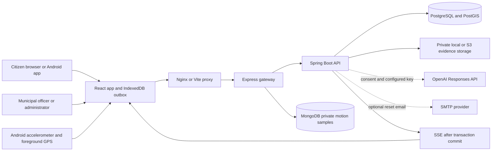
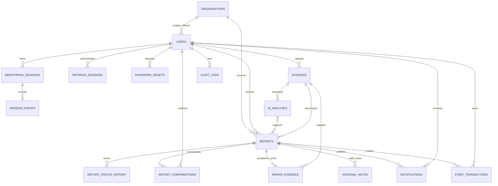
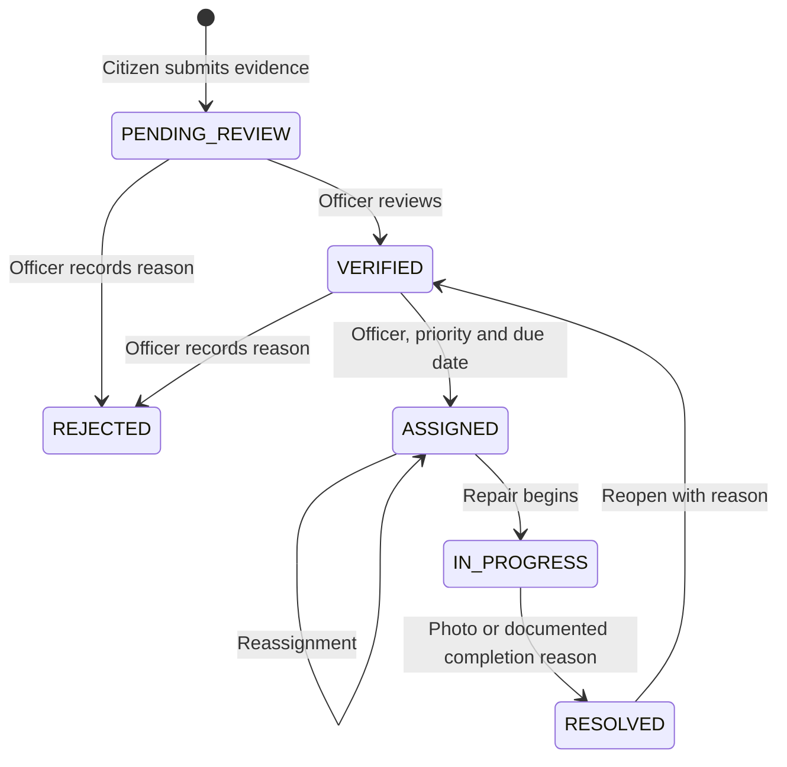

# Architecture and data model

The Spring Boot service is the authority for identity and civic workflows. The Express service checks Spring sessions before accepting telemetry and never assigns client-supplied user IDs. PostgreSQL transactions tie report mutations to timelines, points, notifications and audit events. SSE is emitted after commit; the UI also polls every minute.

## Core ER diagram

The executable schema is `backend/src/main/resources/db/migration/V1__foundation.sql`. It includes foreign keys, enum constraints, indexed geography, one active monitoring session per user, unique report request IDs, unique confirmations and unique point-award reasons.

MongoDB's `motion_samples` documents contain a server-derived user ID, session ID, sample ID, acceleration, jerk, coordinates, speed, GPS accuracy, recorded time and expiry time. A compound unique index makes ingestion idempotent; a TTL index removes samples after seven days. Session ownership and time bounds are checked through Spring before writes. MongoDB is not a store for authentication secrets or report statuses.

## Repair lifecycle

Public lists exclude rejected reports. Rejected details remain readable by the reporter and authorized city staff. Internal notes never appear in citizen responses. Officers may only manage reports in their assigned jurisdiction. Administrators have platform-wide access.

## Offline behavior

The production service worker caches the app shell and immutable assets, not authenticated API responses or external map tiles. IndexedDB stores unsent image blobs and report inputs under their owner ID. A retry checks the active server account, persists the uploaded evidence ID, submits the stable client request ID, and only removes a draft after server confirmation. Reconnection triggers foreground sync; the outbox also provides a manual retry button. Browser background sync is not relied on.

Sensor candidates and raw samples use a separate owner-scoped queue. GPS must be fresh and accurate for candidate creation. No coordinates are fabricated when location is absent. Candidate events remain `UNVERIFIED` and do not become public potholes automatically.

## Deliberate boundaries

- PostGIS handles real meter-based `ST_DWithin` queries and jurisdiction containment. Coordinates are validated and indexed.
- Duplicate suggestions are nearby unresolved reports of the same type; a human chooses whether to confirm an existing report.
- Hotspots are approximately 100 m coordinate-cell aggregations, not a traffic-risk prediction.
- Proximity alerts use straight-line distance and a cooldown. They do not claim the driver is on the same road segment.
- Prioritization text uses stored severity, age and confirmations. It does not invent traffic volume or accident history.
- AI is advisory. Officers remain responsible for verification and repair decisions.
